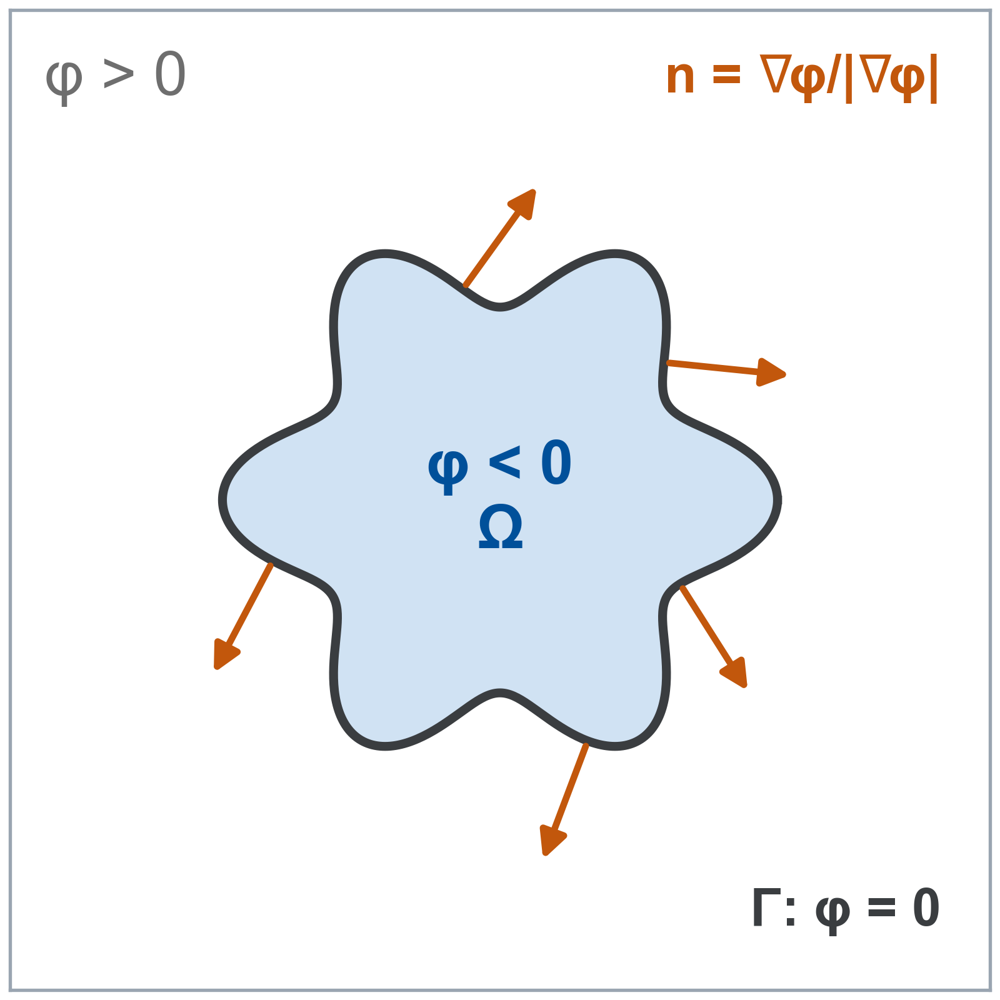
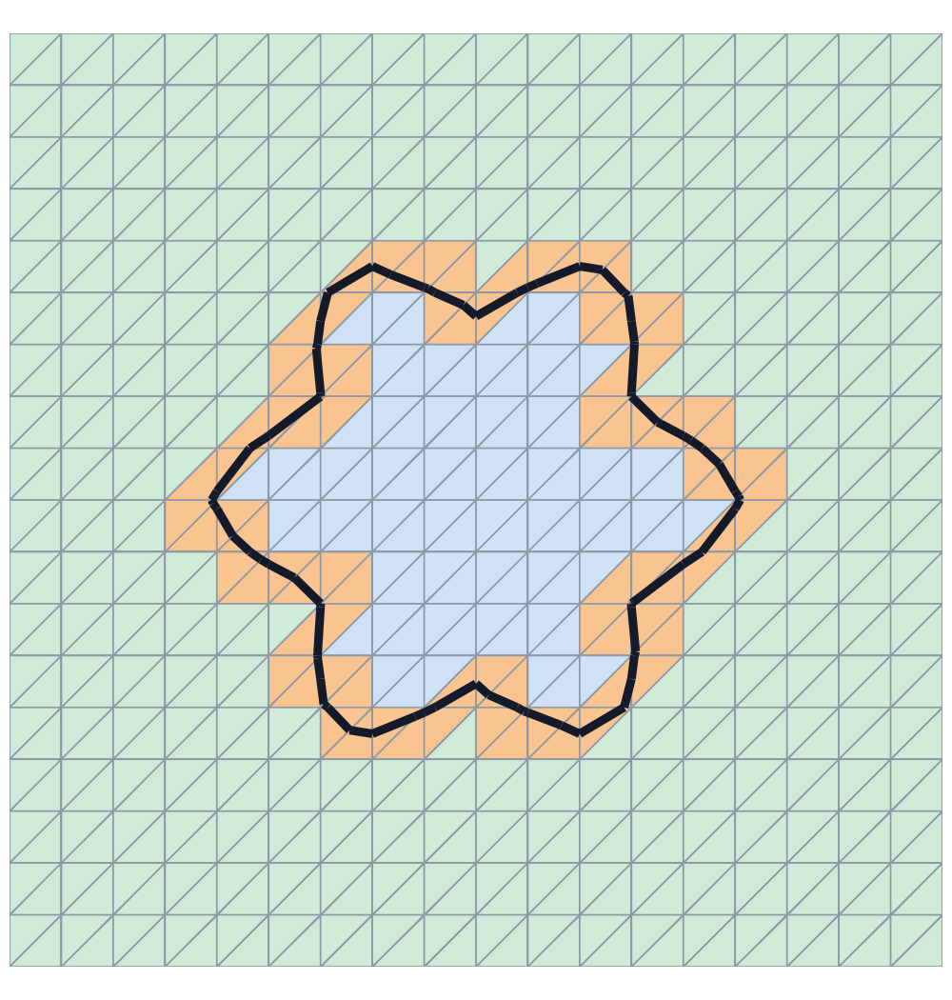
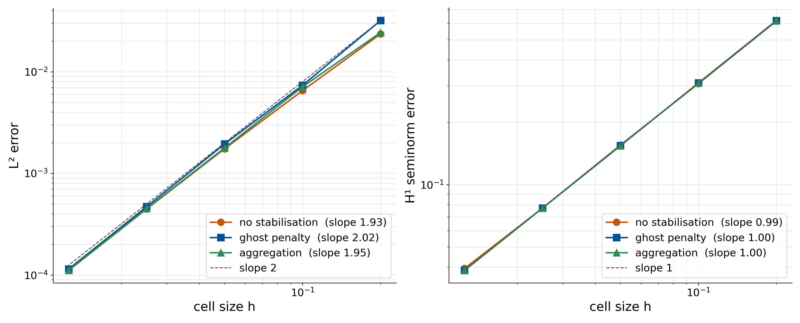
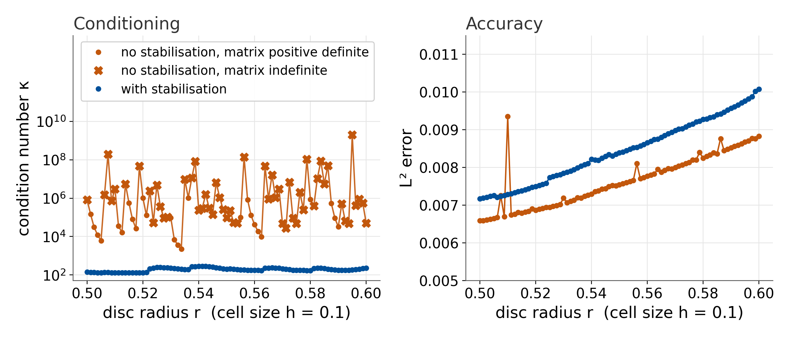
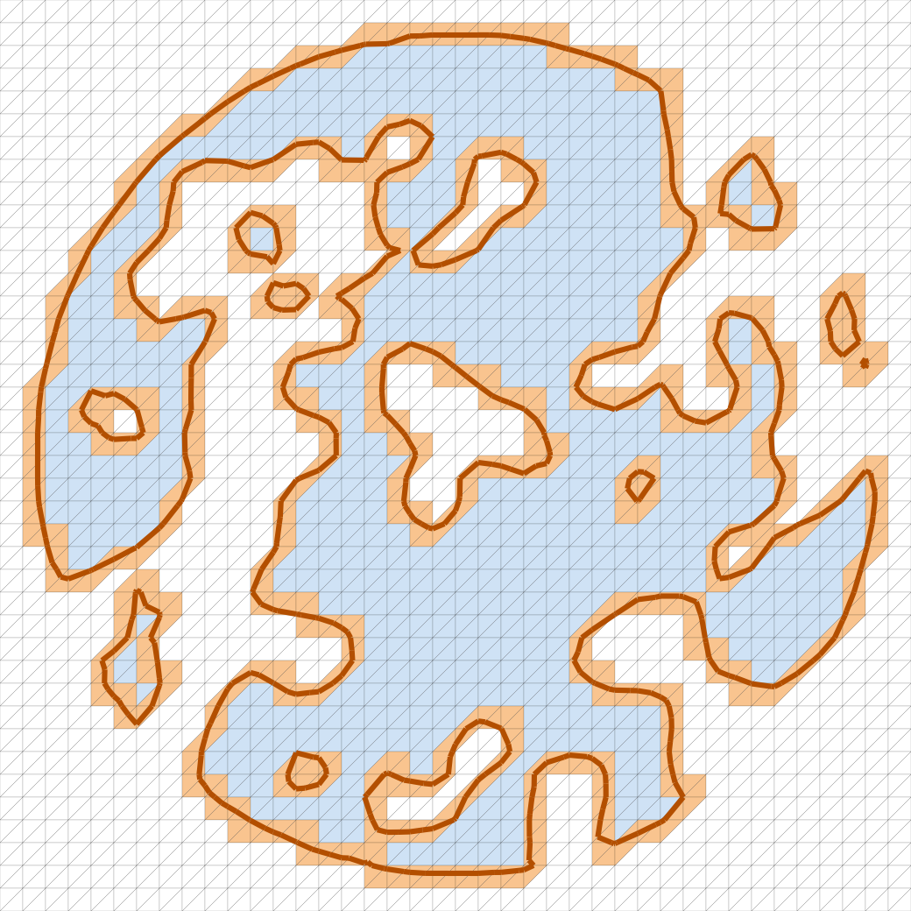
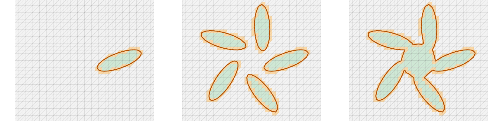
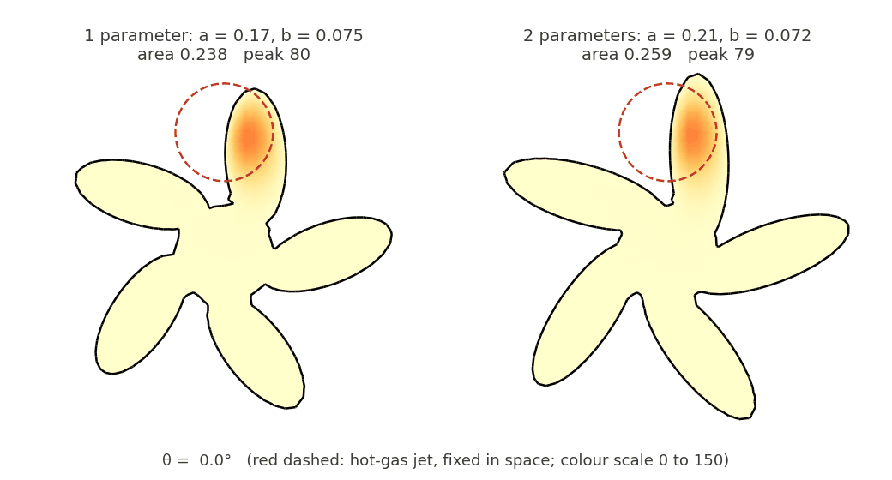
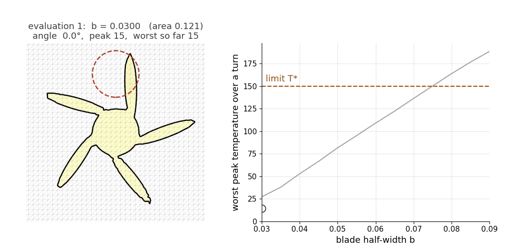
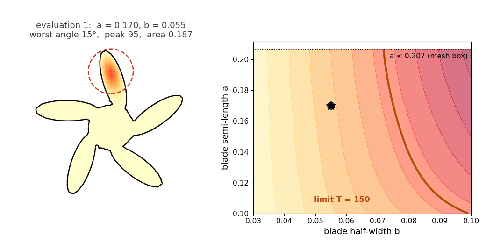

# cutfem-lecture

Hands-on material for a lecture on **cut finite element methods** (MINES Paris – PSL, second-year engineers).
CutFEM in pure Python, 2D for Poisson, and a notebook that follows the lecture: every cell runs, and you change parameters to see what happens.
It needs only numpy, scipy and matplotlib: no FEniCSx installation, works on Windows, macOS and Linux. For 3D applications and other equations use CutFEMx.

| Path | Content |
|---|---|
| `notebooks/cutfem_lecture.ipynb` | the notebook: start here |
| `pyproject.toml` | makes `pip install <repository zip>` install minicut |
| `minicut.py` | the cut FEM module (2D, P1, Nitsche, ghost penalty, cell aggregation), commented |
| `tools/make_notebooks.py` | rebuilds the notebook (the notebook text lives there) |
| `slides/` | the lecture deck (HTML slides, images), see `slides/README.md` |
| `notes/speaker-notes.md` | speaker notes of all slides, in order (generated from the deck) |
| `tools/deck_tools.py` | local preview of the deck and export of the speaker notes |

## Gallery

Figures from the lecture, all produced with `minicut`.

**Example 1: Poisson on a flower.** The level set, the cut cells, convergence, and the small-cut problem.

<table>
<tr><td align="center" valign="top"><br><sub>Level set: negative inside Ω, Γ where φ = 0</sub></td><td align="center" valign="top"><br><sub>Inside (blue), cut (orange) and outside cells</sub></td><td align="center" valign="top"><br><sub>Errors converge at the optimal rates</sub></td><td align="center" valign="top"><br><sub>Condition number against radius: without and with the ghost penalty</sub></td></tr>
</table>

**Example 2: a scan.** A pixel image becomes a level set and is solved in the solid matrix of a porous specimen.

<table>
<tr><td align="center" valign="top"><br><sub>Cut cells of the background mesh</sub></td><td align="center" valign="top"><br><sub>Solution in the matrix, pores are holes</sub></td></tr>
</table>

**Example 3: a rotor.** Built from simple level sets, turned through a hot-gas jet and tuned by an optimisation loop. The mesh never changes.

<table>
<tr><td align="center" valign="top"><br><sub>One blade, five blades, the rotor with its hub</sub></td><td align="center" valign="top"><br><sub>One versus two design parameters, turning through the jet</sub></td></tr>
<tr><td align="center" valign="top"><br><sub>The optimisation loop: widest blade within the temperature limit</sub></td><td align="center" valign="top"><br><sub>The two-parameter loop (derivative-free)</sub></td></tr>
</table>

## Install only minicut (one line)

```bash
pip install https://github.com/sclaus2/cutfem-lecture/archive/main.zip
```

This installs `minicut` and numpy, scipy and matplotlib, so `import minicut` works in any folder (no git needed).
The notebooks are not part of the package: use the steps below.

## Run the notebook locally

You need Python 3.9 or newer. In a terminal:

```bash
git clone https://github.com/sclaus2/cutfem-lecture.git
cd cutfem-lecture
python3 -m venv .venv
source .venv/bin/activate          # Windows (PowerShell): .venv\Scripts\Activate.ps1
pip install -r requirements.txt
jupyter lab notebooks/cutfem_lecture.ipynb
```

(On Windows `python` replaces `python3`.) Jupyter opens in your browser. Run the cells from top to bottom with
Shift+Enter. The whole notebook takes about a minute. VS Code with the Python and Jupyter extensions also works:
open the notebook and select the `.venv` interpreter.

Keep the folder structure: the notebook finds `minicut.py` in the folder above it.

## What `minicut` does

Problem: `-Δu = f` in Ω, `u = g` on Γ, P1 elements on a structured triangle mesh with a P1 level set.
Level set from a formula, CSG or an image; cell classification; exact sub-triangulation and quadrature on
Ω∩T and Γ∩T; Nitsche's method; ghost penalty; cell aggregation (`aggregate`, `solve_aggregated`); and the
measurements of the conditioning block of the lecture (`condition_number`, `smallest_mode`, `gmres_iterations`, with
`tools/cond_sweep.py` for the radius sweep). The three examples of the lecture (Poisson on a flower, a porous
specimen from an image solved in the solid matrix, a rotor) all run on it; the figure scripts are in `tools/`.

On the same mesh, level set and parameters (Nitsche γ = 40, ghost penalty γ_g = 0.1), `minicut` agrees with
[CutFEMx](https://github.com/sclaus2/CutFEMx): L2 errors to about 5 digits, condition numbers to 12 digits.
Measured convergence: L2 rate 2, H1 rate 1.

## Not tested

Only the local Jupyter route above has been run. Google Colab, Binder, JupyterLite and Pyodide have not.

## Licence

MIT, see `LICENSE`.
